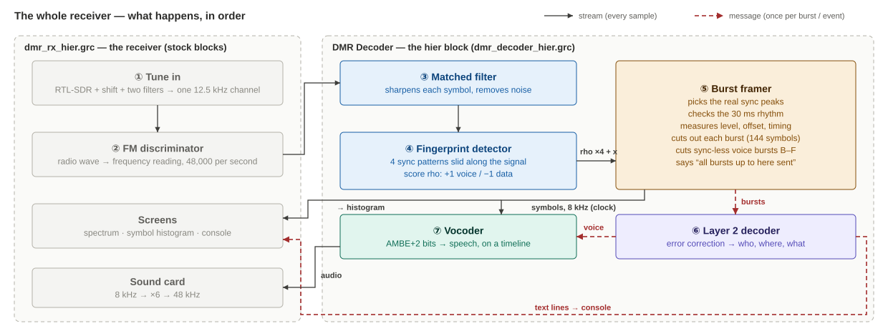
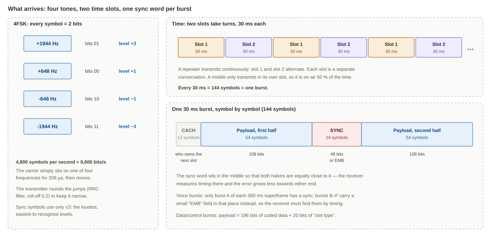
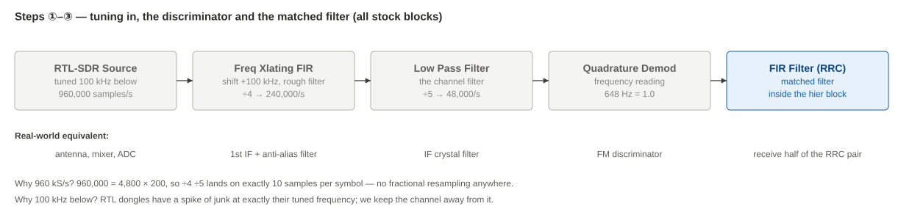
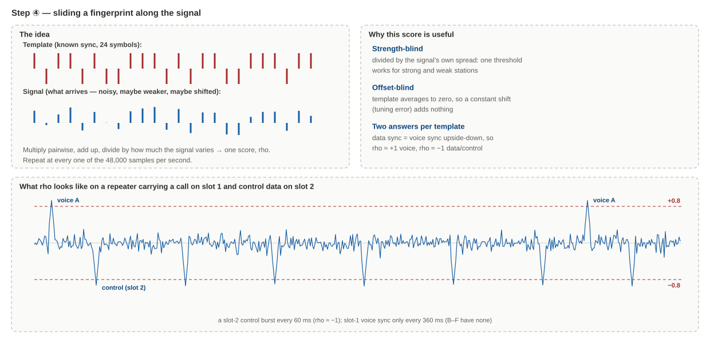
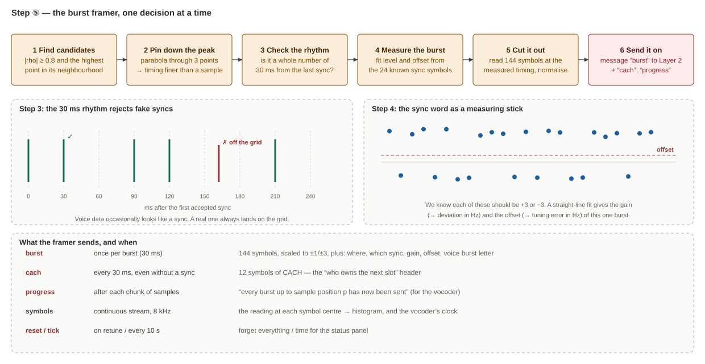
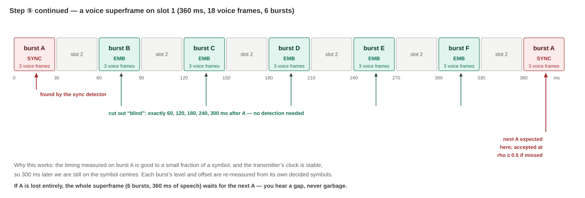
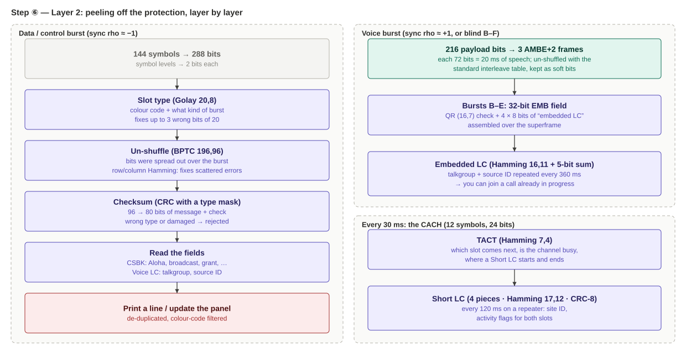
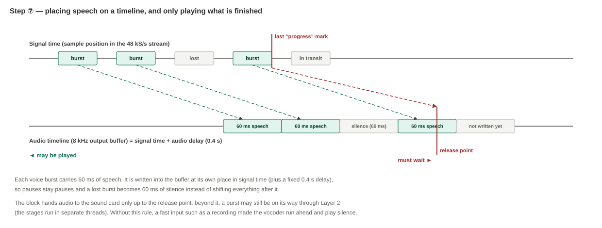
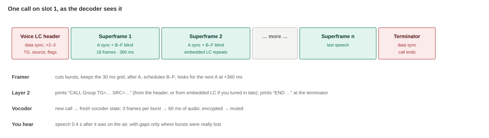

# Decoding DMR with an RTL-SDR and (Mostly) Stock GNU Radio Blocks

*A long, honest walkthrough of my DMR receiver: how a cheap dongle and a pile of GNU Radio blocks can find DMR bursts, read who is talking to whom, follow a Tier III control channel, and turn the voice bits back into speech you can actually hear.*

---

## Why I did this

It started with a mistake. I saw a signal on 148.8 MHz that looked like P25 on the waterfall, so I built a P25 decoder for it. I ran it, and the decoder kept printing... DMR repeater syncs. So it was never P25. It was DMR all along.

I've been a DMR user for a while as a ham. I know the user side well: talkgroups, timeslots, colour codes, hotspots. But I realised I had never really understood what happens *inside* the radio between the antenna and the speaker. The radio just does it, and the MMDVM firmware just does it, and I took all of it for granted.

So I wanted to see it with my own eyes. Not "trust me, DSD did it", but actually watch the bursts being found, the error correction being peeled off, and the voice coming out at the end. That is what this receiver does. Every stage in it is a block you can open and poke with a scope.

This write-up is the story of how it works, written for the version of me that kept pressing PTT without ever wondering what the 4FSK actually looks like.

A warning before we start: I use some DSP and coding words here (matched filter, correlation, Golay, BPTC, vocoder...). I'll explain each one the first time it shows up. You don't need any maths to follow the story, but there are a few equations for those who like them.

---

## What I used

- **RTL-SDR dongle**. Any RTL-SDR works. One with a TCXO (RTL-SDR Blog V3/V4) saves you from fiddling with the ppm correction.
- **A VHF/UHF antenna** that can hear a DMR repeater. Nothing fancy, a repeater is loud.
- **Windows laptop** with **radioconda** (GNU Radio 3.10). No out-of-tree modules: only stock blocks plus Embedded Python Blocks.
- **mbelib-neo** (`mbe-neo.dll`) for the AMBE+2 voice. Without it, everything still decodes, only the audio stays silent.

The files:

- **dmr_rx_hier.grc**: the receiver (RTL-SDR source, filters, discriminator, GUI, audio)
- **dmr_decoder_hier.grc**: hier block, the DMR decoder itself, with its belly opened up
- **dmr_decoder_hier_explained.md**: the same thing in compact technical form
- **dmr_how_it_works.md**: how DMR itself works: repeaters, hotspots, networks

There is also a simpler, faster sibling, **dmr_rx.grc**, which does the whole decoding inside one Python block. The hier version is the same decoder, split into stages so you can watch each one.

---

## The rule I followed

My personal rule for these GNU Radio projects is simple:

> Put each operation in a stock block if one exists. Use an Embedded Python Block (EPB) only for what GNU Radio cannot do natively.

Every stock block's output is a stream, and every stream can be dropped into a QT GUI sink. So the more of the receiver I build from stock blocks, the more of its insides I can *watch*.

For DMR, Python only gets the jobs stock blocks genuinely can't do:

1. deciding which sync peaks are real, and cutting out bursts at a measured timing (**the framer**),
2. all the DMR error correction and message parsing (**Layer 2**),
3. calling the AMBE+2 voice decoder, and placing the audio on the right timeline (**the vocoder**).

Here is the whole receiver on one page:



Grey boxes are the receiver's stock blocks, blue boxes are stock blocks inside the hier block, and amber, purple and green ones are the three Python blocks. Solid arrows are **streams** (numbers flowing all the time, like an audio cable). Dashed red arrows are **messages** (one packet per event, like an e-mail: "here is a burst", "here is a line of text").

DMR is naturally a mix of both. The radio signal is continuous, but the information comes in 30 ms packets. Keep this picture in mind; the rest of the story walks through it step by step.

---

## Part 1: what a DMR signal actually is



### Four tones

DMR is basically FM with four fixed frequency positions, called **4FSK**. The carrier sits at +1944, +648, −648 or −1944 Hz for one symbol (208 µs), then jumps to the next one. Each position carries 2 bits. That's 4,800 symbols per second, so 9,600 bit/s.

The transmitter rounds off each jump with a **root-raised-cosine (RRC)** filter (roll-off 0.2), which keeps the signal inside a 12.5 kHz channel.

### Two timeslots

Time is cut into 30 ms slices that alternate: slot 1, slot 2, slot 1, slot 2... Each slot is a completely separate conversation. That's why one repeater carries two talkgroups at once.

Please note that a repeater transmits in *both* slots all the time, sending "idle" bursts when nothing is going on. A mobile only transmits in its own slot, so it's on the air half the time.

### One burst = 144 symbols = 30 ms

| Part | Symbols | What it is |
|---|---|---|
| CACH | 12 | A small header from the repeater: which slot comes next, is the channel busy, plus pieces of a "Short LC" message |
| Payload, first half | 54 | 108 bits of voice or data |
| Sync (or EMB) | 24 | A fixed 48-bit pattern: "a burst is here, and it is this kind". In most voice bursts it's replaced by a small "EMB" field |
| Payload, second half | 54 | Another 108 bits |

The sync sits **in the middle** on purpose. The receiver measures the timing there, and both halves of the payload end up equally close to the spot where the timing is best known. Clever.

### What my receiver doesn't know

| Unknown | Where it comes from | Typical size |
|---|---|---|
| **Where the bursts start** | I switch on at a random moment | Anywhere |
| **Symbol timing** | Where the best sampling instant sits inside each 208 µs symbol | Any fraction of a symbol |
| **Tuning error** | The repeater's crystal plus my dongle's crystal | A few hundred Hz with a TCXO, several kHz without |
| **Deviation** | Every transmitter is set up a bit differently | ±5 % around 1944 Hz |
| **Which slot is which** | The repeater tells us, in the CACH | Has to be decoded |
| **Which bursts are voice B–F** | Five out of six voice bursts have **no sync at all** | Has to be worked out from timing |

### Why the obvious GNU Radio chain isn't enough

My first attempt was the usual one: FM demod, then `Symbol Sync` for clock recovery, then a 4-level slicer, then search for the sync bits. It sort of works. It falls short in four places:

- **The timing loop has to chase the signal.** Clock recovery adjusts a little at a time, so after a retune or a key-up it needs many symbols to get back into step. (This bit me hard, see war story 2.)
- **Voice data sometimes looks like a sync word.** Compressed speech is basically random bits, and over hours some of it will match. GNU Radio has no block that knows a repeater keeps a strict 30 ms rhythm.
- **There are no DMR error-correction blocks.** DMR uses Golay, BPTC, Hamming, quadratic-residue and Reed-Solomon codes, plus checksums with per-type masks. None of them are in GNU Radio.
- **There's no AMBE+2 decoder.** The voice codec is proprietary. mbelib-neo can decode it; GNU Radio can't.

So my approach became: **stock blocks for everything that runs on every sample (filtering, correlating), Python for everything that happens once per burst.**

---

## Part 2: tuning in, demodulating and sharpening



### Tuning in

**Blocks:** `RTL-SDR Source` → `Frequency Xlating FIR Filter` → `Low Pass Filter`

1. **The dongle is tuned 100 kHz below the repeater.** Every RTL-SDR has a small spike of junk exactly at its tuned frequency (DC offset in its mixer). Tuning off to one side keeps that spike out of my channel.
2. **The first filter** slides the channel back to the centre, cuts everything beyond ±40 kHz, and keeps one sample in four: 960 kS/s → 240 kS/s. It only has to stop things folding back when the rate drops, so it can be cheap.
3. **The second filter** is the real channel filter. It removes everything outside the 12.5 kHz channel and keeps one sample in five: 240 kS/s → 48 kS/s.

Why these odd numbers? 960,000 = 4,800 × 200. Dividing by 4 and then by 5 lands on exactly **10 samples per symbol**. One symbol is 10 samples, one burst is 1,440, one voice superframe is 17,280. No fractions, no resampling anywhere. That choice saves a lot of pain later.

### The FM discriminator

**Block:** `Quadrature Demod`

This is the software version of an FM discriminator. For every sample it outputs how far the frequency is from the centre at that instant. I scaled it so that **648 Hz reads as 1.0**, so the four DMR tones read +3, +1, −1, −3. Those are exactly the "symbol levels" the DMR standard (ETSI TS 102 361) talks about.

A tuning error shows up as *every* reading being shifted up or down by the same amount. I call that the **offset**. The framer measures and removes it later (Part 4), so a slightly mistuned dongle still decodes.

### The matched filter

**Block:** `FIR Filter` with RRC taps. This is the first block inside the hier block.

The transmitter shaped each symbol with an RRC filter. Running the received signal through **the same shape again** does two nice things:

- **It removes as much noise as possible.** A filter shaped exactly like the expected signal lets the signal through and blocks the most noise. Think of a key cut for one lock.
- **Each symbol reaches its level cleanly at its centre.** Two RRC filters in a row make a "raised-cosine" response, which has a lovely property: at the exact centre of each symbol, its neighbours contribute *nothing*. Sample there and you read +3, +1, −1 or −3 without any smearing from either side.

I call the output `x`. It's 48,000 numbers per second, and every 10th one, if you pick the right ones, is a clean symbol.

**Which ones are "the right ones" is exactly what I don't know yet.** That's the next part.

---

## Part 3: spotting sync words with stock blocks



### The fingerprint idea

Every burst with a sync carries one of a handful of known 24-symbol patterns. I use each one as a **fingerprint**, and at every one of the 48,000 samples per second I ask: *"If a sync ended right now, how well would the last 24 symbols match?"*

"The last 24 symbols" means 24 samples spaced exactly 10 apart, ending at the current sample. A FIR filter whose taps are zero except at every 10th position computes exactly that. That's why this whole detector can be built from stock blocks (16 of them in total).

The match becomes a score I call **rho**, between −1 and +1. Written out, with $x_k$ the 24 symbol-spaced samples and $t_k$ the fingerprint (±3):

$$\rho = \frac{\sum_k t_k\, x_k}{\sqrt{\sum_k t_k^2}\;\sqrt{\sum_k x_k^2 - \tfrac{1}{24}\big(\sum_k x_k\big)^2}}$$

In blocks:

1. **Correlate.** One `FIR Filter` per fingerprint does the top line.
2. **Measure the spread.** Two more `FIR Filter`s add up the same 24 samples ($\sum x$) and their squares ($\sum x^2$). A handful of `Multiply`, `Multiply Const`, `Subtract`, `Add Const` and a `Transcendental` (sqrt) turn those into the bottom line.
3. **Divide.** And there's rho.

### Why this score is so nice

| Property | How | Why it matters |
|---|---|---|
| **Doesn't care how strong the signal is** | Dividing by the spread cancels the signal level | One threshold (0.8) works for the repeater next door and the one 50 km away |
| **Doesn't care about tuning error** | Every fingerprint has as many +3 as −3, so a constant shift adds nothing | It locks before I've fixed my ppm |
| **One fingerprint, two answers** | DMR's data sync is the voice sync with every symbol flipped | rho ≈ +1 means voice, rho ≈ −1 means data/control |

So **4 fingerprints cover 8 sync types**:

| Fingerprint | rho → +1 | rho → −1 |
|---|---|---|
| BS | repeater voice | repeater data / control |
| MS | mobile voice | mobile data |
| DM1 | direct mode, slot 1 voice | slot 1 data |
| DM2 | direct mode, slot 2 voice | slot 2 data |

It's the same normalised-correlation trick as the preamble detector in my AIS receiver, just four fingerprints instead of one.

### What it looks like

The bottom of the picture shows rho from the BS fingerprint on a repeater with a voice call on slot 1 and control data on slot 2:

- **Down to −1 every 60 ms:** slot 2's control bursts, each with a data sync.
- **Up to +1 every 360 ms:** slot 1's voice. Only one burst in six has a sync (Part 4).
- **Everything else** hovers near zero, because random data doesn't look like any fingerprint.

You can see this live: drop a **QT GUI Time Sink** on the `rho_bs` output inside the hier block. It's honestly one of my favourite screens in the whole project.

---

## Part 4: the framer, where streams become bursts



Up to here, every block works on every sample without knowing anything about bursts. The **framer** (an EPB) is where the receiver starts thinking in bursts. It's the heart of the whole thing, so this part is the longest.

### Step 1: find candidates

The framer looks for places where |rho| ≥ 0.8 **and** rho is the highest point around it. A sync gives a sharp peak, but its neighbours score high too, and I only want the top.

### Step 2: pin down the peak

The true symbol centre almost never falls exactly on a sample. So I fit a parabola through the peak and its two neighbours, and take the top of the curve. That gives the burst timing to a small fraction of a sample.

Like measuring a hill's height at three spots along a path: you can tell roughly where the summit is, even if you never stood exactly on top.

### Step 3: check the rhythm (the 30 ms grid)

A repeater sends a burst every 30 ms, exactly. So once I've seen a real sync, every later real sync must land a whole number of 30 ms steps after it. A "sync" that's off the grid gets thrown away.

The rules I ended up with:

- The grid is trusted only after **two syncs agree on it within one second**. One sync alone could itself be a fake.
- Once trusted, it stays trusted for **half a second** after the last good sync, then has to be confirmed again.
- If a repeater (BS) sync was seen in the last two seconds, mobile and direct-mode syncs are ignored. On a repeater frequency they can only be fakes.

(Why all this fuss? See war story 3.)

### Step 4: measure the burst

I know what the 24 sync symbols *should* be: each exactly +3 or −3. I also have what they *actually* read. A straight-line fit through the 24 pairs,

$$y_k = g\, s_k + o$$

gives two numbers for this one burst: the **gain** $g$ (how big a "3" really reads) and the **offset** $o$ (how far every reading is shifted). Then:

- carrier offset = $o \times 648$ Hz (also shown in ppm),
- deviation = $|g| \times 1944$ Hz.

Both show up in the status panel. The framer then refines the fit over the whole burst: it decides all 144 symbols with the first estimate and fits again with all of them, because 144 points are steadier than 24.

This is the "use the known part as a measuring stick" trick, and it's why I don't need a perfectly tuned dongle. A 1 kHz error just becomes an offset that gets measured and subtracted.

### Step 5: cut it out

Knowing the timing to a fraction of a sample, the framer reads all 144 symbols at their exact centres. It interpolates between samples with a smooth curve (Catmull-Rom), then computes $(y - o)/g$, so every symbol comes out as a clean number near +3, +1, −1 or −3.

**It doesn't round them yet.** +2.1 means "probably +3, but not sure", and +2.9 means "definitely +3". That confidence is kept and used later by the error correction and the vocoder. Rounding now would just throw information away.

### The tricky bit: voice bursts without a sync



Voice is sent in **superframes** of six bursts, A to F, on the same slot, 60 ms apart: 360 ms of speech in total. **Only burst A has a sync.** In B to F, the sync position carries a 16-bit "EMB" field instead (colour code plus a piece of the caller's info). DMR does this to squeeze more control info into a call.

So my fingerprint detector sees voice only once every 360 ms. The framer handles it like this:

1. When it accepts a burst A, it **schedules** B, C, D, E and F at exactly 60, 120, 180, 240 and 300 ms later, and cuts them out "blind" when the signal gets there.
2. The timing measured on A is good enough for that. The transmitter clock is stable, and 300 ms later the error is still a small fraction of a symbol. Each blind burst's gain and offset are re-measured from its own symbols.
3. At 360 ms it expects the next A. If the detector found it, fine. If it was **missed** (rho stayed below 0.8 because of a fade), the framer checks rho at that predicted spot, and **0.5 is enough** there. When you already know where to look, a much lower score is still convincing.

**If burst A is lost completely**, the framer doesn't guess. The whole superframe is skipped: 360 ms of silence, never 360 ms of garbled noise. A real radio does the same.

### What the framer sends on

| Message | When | What it carries |
|---|---|---|
| `burst` | Once per burst | 144 symbols plus where it is, which sync, voice or data, letter A–F, gain, offset |
| `cach` | Every 30 ms on the grid, even without a sync | The 12 CACH symbols |
| `progress` | After every chunk of samples | "Every burst up to position *p* has been sent" (the vocoder needs this, Part 6) |
| `reset` | When I retune | "Forget everything about this channel" |
| `tick` | Every 10 s | "Time to print the status panel" |

It also outputs one **stream**: the reading at each symbol centre, held at 8 kHz. That drives the symbol histogram on the screen, and it's also the vocoder's clock.

---

## Part 5: Layer 2, peeling the onion



DMR protects nearly everything with error correction: extra, carefully chosen bits that let the receiver find and repair a few wrong ones. Different parts of a burst get different codes, depending on how important they are. The **Layer 2** EPB takes them off one by one, like peeling an onion.

It uses each symbol's confidence from Part 4. This "soft" decoding repairs noticeably more errors than working with plain 0s and 1s, because the decoder knows which bits are doubtful.

### Every 30 ms: the CACH

The 12 CACH symbols (24 bits) are only sent by a repeater:

- **TACT** (Hamming (7,4), fixes 1 wrong bit) says **which slot the next burst belongs to**. That's how I know if a burst is slot 1 or slot 2. It also has the busy flag, and says where a Short LC starts and ends.
- **A Short LC fragment** (17 bits). Four of them, over 120 ms, make one Short LC message (Hamming (17,12) rows plus CRC-8). On a Tier III control channel it carries the site identity. On a conventional repeater it says what each slot is doing.

### Data and control bursts (rho ≈ −1)

1. **Slot type** (20 bits around the sync, Golay (20,8), fixes up to 3 wrong bits). It gives the **colour code** and **what kind of burst this is**: voice header, terminator, CSBK, idle, data header... If it can't be repaired, the burst is dropped. Without the type, nothing else can be read.
2. **BPTC (196,96).** The other 196 bits are 96 bits of info in a grid, with Hamming checks on every row and column, then **shuffled** across the burst. A short fade or click damages a run of neighbouring bits; after un-shuffling, those errors are scattered, which is exactly what row-and-column codes are good at fixing.
3. **Checksum.** CRC-16 for most types, Reed-Solomon (12,9) for the voice header and terminator. Each type XORs its check with a **different mask**, so a burst decoded as the wrong type fails. Failed means dropped, and counted in the panel.
4. **Read the fields:**

| Burst type | What Layer 2 prints or learns |
|---|---|
| Voice LC header | `CALL Group TG=… SRC=…`: a call starts, plus emergency/encryption flags |
| Terminator with LC | `END …`: the call ended |
| PI header | The call is encrypted (algorithm, key ID) |
| CSBK | Tier III control: C_ALOHA, C_BCAST (site, neighbours, frequencies), channel grants |
| Data header | A data transfer (GPS, text...) with source and destination |
| Idle | Nothing, just counted |

### Voice bursts (rho ≈ +1, plus the blind B–F)

The 216 payload bits are **three AMBE+2 frames of 72 bits**, 20 ms of speech each. Layer 2 puts the bits back in order (the standard interleaves them, so a noise burst hits several frames a little instead of one frame badly), then sends them to the vocoder **as soft values**, with the slot, the burst's position in time, and the encryption flag.

Layer 2 doesn't error-correct the voice itself. AMBE+2 has its own protection inside each 72-bit frame, and the vocoder handles that.

### Bursts B–F: the embedded LC

The EMB field is protected by a quadratic-residue (16,7) code (fixes up to 2 wrong bits). Bursts B, C, D and E each carry 32 bits of **embedded LC**, 128 bits together: the same talkgroup and source ID as the voice header, with Hamming (16,11) rows, column parity and a 5-bit checksum.

Why bother? The voice header only comes at the start of a call. If you tune in halfway, you missed it. The embedded LC repeats the caller info **every 360 ms during the call**, so the decoder can tell you who's talking within half a second. That's also why your radio shows the caller ID even when you key up late.

### The channel picture

Layer 2 also **remembers** everything: offset and deviation, channel type, site and neighbours, colour codes, what each slot is doing, recent calls, and counters for what was decoded and rejected (and why). Every 10 s it prints it all as the status panel.

### Channel numbers into frequencies

A Tier III network doesn't put frequencies in its grants. It sends **channel numbers** (LPCN) to keep the messages short. Some sites broadcast the frequency for each number (C_BCAST "Chan_Freq"); when they do, Layer 2 learns it.

When they don't, you can enter the network's **channel plan** in the block's properties:

$$f(n) = f_{\text{ref}} + (n - n_{\text{ref}}) \times 12.5\ \text{kHz}$$

One known channel number, its frequency, and the step. On the network I listened to, I confirmed the plan from three independent points before trusting it. After that, every grant and neighbour line shows a real frequency in MHz.

---

## Part 6: the vocoder, and why audio needs a timeline



### What a vocoder does

AMBE+2 doesn't send a sound wave; it sends a *description* of one. Every 20 ms: the pitch, how loud each frequency band is, and whether each band is voiced (a vowel) or unvoiced (a hiss). That's 49 bits of parameters plus 23 bits of protection = 72 bits. The vocoder rebuilds 160 audio samples at 8 kHz from it.

That's why DMR sounds a bit robotic, and why a few wrong bits make it warble instead of click.

I call **mbelib-neo** through `ctypes`, using its **soft-decision** function. It gets each bit's confidence from the framer, so its own error correction can repair more frames than it could with hard 0s and 1s.

### One vocoder per slot, fresh for each call

AMBE+2 sends some parameters as "the change since last frame", so the decoder has memory. The block keeps **one vocoder state per slot**, and resets it when a new call starts (no voice on that slot for more than about 0.2 s). Otherwise the new talker would start with the last talker's voice.

**Encrypted calls are muted.** Decoding them would just give loud noise. You get one "encrypted call: audio muted" line instead.

### Why placed, not queued

The obvious design is a queue: decode three frames, push 60 ms of audio, let the sound card pull it out. I tried that first and didn't like it (war story 4):

- **Pauses disappear.** A 2 s gap between overs vanishes, and the next over starts early.
- **Lost bursts shift everything.** Over a long call the audio drifts against the signal.
- **GNU Radio delivers data in chunks** of unpredictable size, so the queue alternates between empty (stutter) and overfull (lag).

So instead, each burst's 60 ms of audio is **written into a timeline at the moment it was on the air**, plus a fixed delay $D$ (0.4 s by default). The burst's sample position $p$ (at 48 kS/s), recorded by the framer, says exactly where:

$$\text{audio index} = \frac{p + D \times 48000}{6}$$

The division by 6 is because six 48 kS/s samples make one 8 kHz audio sample. A pause stays a pause, a lost burst becomes 60 ms of silence, and nothing can drift, because audio time is tied to signal time.

### Only play what's finished

The vocoder's output must be a steady 8,000 samples per second, so it needs a clock: the framer's 8 kHz symbol stream. The catch is that the framer, Layer 2 and the vocoder **run in separate threads**. A voice message can still be on its way through Layer 2 when the clock has already moved past the spot where its audio belongs.

So the block only plays audio **up to the release point**: the last `progress` mark from the framer, plus the delay. Beyond it, a burst might still be in transit. Before it, every burst is guaranteed to have arrived. (I learned this the hard way, war story 6.)

### To the speaker

The receiver multiplies by the volume slider, a `Rational Resampler` goes ×6 to 48 kHz, and an `Audio Sink` plays it. You hear speech about **0.4 s after it was on the air**. That's the price of never stuttering.

---

## What you'll see on the screen

**Spectrum:** a repeater is a flat-topped hump about 10 kHz wide that never switches off. A mobile in direct mode flickers on and off.

**Symbol histogram:**

| What you see | What it means |
|---|---|
| **Four sharp, equal peaks at −3, −1, +1, +3** | Locked, clean signal |
| Four peaks, all shifted sideways | Tuning error. The framer removes it, but fix your ppm / `fine_hz` anyway |
| Peaks spread wide and merging | Weak signal or interference |
| One blob, no peaks | No DMR, or not locked yet |

**Console:** event lines as they happen. These are from a test run (on a synthetic recording):

```
[DMR 20:43:41] TS2 CC1 CALL Group TG=6001 SRC=423  (dev=1956Hz off=+130Hz)
[DMR 20:43:46] TS2 CC1 END  Group TG=6001 SRC=423  (dev=1944Hz off=+132Hz)
```

**TS2** is the timeslot (from the CACH), **CC1** the colour code (from the slot type), then the talkgroup and radio ID, then this burst's measured deviation and offset.

And every 10 s, the status panel:

```
 DMR channel status   20:43:43   (running 1 s)
 Frequency   : 148.80000 MHz   carrier offset +129 Hz  ~+0.9 ppm   deviation 1958 Hz
 Channel type: repeater / base station (BS sync); Tier III CONTROL channel (TSCC)
 Colour code : CC1 (84 bursts)
 TS1         : idle
 TS2         : voice Group TG=6001 SRC=423
 Calls (last 5 min, newest first):
    20:43:43  Group TG=6001 SRC=423                voice here on TS2
 Decoder     : bursts 154 (idle 81, voice superframes 12)  rejected: slot-type 0, BPTC 0, CRC/RS 0, off-grid/unconfirmed sync 3
```

**The last line is the health check.** "Off-grid/unconfirmed sync 3" means three fake or unconfirmed syncs were caught by the rhythm check. A few is normal. Lots of BPTC or CRC rejections mean the signal is too weak, or there's a second repeater on the same frequency (try setting the colour code).

---

## One call, start to finish



| Moment | On the air | In the decoder | On my screen / speaker |
|---|---|---|---|
| 0 ms | Voice LC header bursts (data sync) | rho → −1, framer accepts, Layer 2 decodes slot type → BPTC → RS | `CALL Group TG=… SRC=…` |
| ≈ 60–120 ms | Burst A (voice sync) | rho → +1, framer cuts A and schedules B–F, fresh vocoder state | Panel: "voice …" |
| +60 … +300 ms | Bursts B–F (no sync) | Cut out blind, EMB decoded, embedded LC collected | (repeated `CALL` line suppressed) |
| ≈ 0.4–0.5 s | (still talking) | First speech reaches the release point | **I hear the first syllable** |
| Every 360 ms | Next A, B–F... | Next A expected; accepted at rho ≥ 0.5 if weak | Continuous speech |
| End | Terminator with LC | Layer 2 decodes it | `END Group TG=…`, call shown as "ended" |

Tuning in halfway through a call? The first two rows never happen, but within one superframe the embedded LC still tells you who's talking, and the audio starts at the next burst A.

---

## War stories (the bugs that taught me something)

Things rarely work the first time. Here are the ones worth telling, because each one taught me something beyond DMR.

### 1. My P25 signal was DMR

The very first one. I built a P25 decoder for a signal that *looked* like P25 on the waterfall, and its sync detector kept printing DMR repeater syncs instead. A 12.5 kHz 4FSK hump looks very much the same whichever standard sent it. Lesson: the waterfall can tell you the bandwidth, not the protocol. Let a sync detector decide.

### 2. Slow lock when sliding, instant lock when preset

In the first DMR version, if I set the offset correctly *before* pressing run, it locked immediately. If I slid the `fine_hz` slider onto the signal while running, it took ages to lock.

The culprit was GNU Radio's `Symbol Sync`. While I was sliding across garbage, its timing loop kept "correcting" towards nonsense and wound itself up. When the real signal finally arrived, it first had to unwind. The fix was to throw away the loop completely and measure the timing **directly from each sync word** (Part 4). Every burst gets its own fresh measurement, so there's nothing to catch up. Lesson: a feedback loop remembers its past, and that's not always what you want.

### 3. Fake syncs inside the voice

With voice on the channel, I occasionally got "bursts" that decoded to nonsense, and audio clicks. AMBE+2 output is essentially random bits, and once in a while 48 of them match a sync pattern well enough to pass 0.8.

A higher threshold would also lose weak real bursts. The real fix was the **30 ms grid** with two-sync confirmation (Part 4, step 3). A fake has to match the pattern *and* land on the grid, and that basically never happens. Lesson: when a signal has structure, use it as a second opinion.

### 4. The stuttering FIFO

My first voice output was a simple queue, and it stuttered: GNU Radio hands blocks chunks of wildly varying size, so the queue kept running empty and then overflowing. Placing audio on a timeline tied to the signal (Part 6) fixed it for good, and as a bonus, pauses and lost bursts are now reproduced faithfully.

### 5. The histogram that flickered

Voice was decoding perfectly, yet the symbol histogram kept jumping between "four sharp peaks" and "scattered mess". The decoding was fine; only the *display* was wrong.

When I changed the framer's output to decimate by 6 (to make the 8 kHz stream), I forgot to convert the symbol phase into a position *relative to the current chunk*. So the histogram was sometimes sampling exactly at the symbol centres and sometimes somewhere in between, depending on how GNU Radio happened to chunk the data. One line fixed it. Lesson: "decodes fine" and "displays fine" are tested by different things.

### 6. The hier block that played silence

Splitting the single block into a hier block brought its own surprises:

- **Reserved pad names.** I named the hier ports `in`, `audio`, `sym` and `text`. GRC didn't like that at all, because those names clash with generated code. They're now `pad_in`, `pad_audio`, `pad_sym` and `pad_text`.
- **The vocoder ran ahead.** With a fast input (a recording), the vocoder's clock outran the voice messages coming through Layer 2 in another thread, and it happily played silence. That's what the `progress` marks and the release point (Part 6) are for.
- **A crash** when the vocoder wrote its whole output buffer instead of only the samples it actually produced.
- **Burst B arriving late**, once every nine superframes or so. The framer scheduled B–F inside a work call, but only processed bursts it had already scheduled *before* that call. Now it keeps a `pending` list and processes newly scheduled bursts in the same call. The release-point check is what exposed this one. Lesson: a strict test catches bugs nobody was looking for.

### 7. The vocoder library hunt

I first looked at three candidates: mbelib, mbelib-neo and "libopendmr". I couldn't find libopendmr anywhere, so that one is out. Classic mbelib works, but only with hard bits, and its output is about 3× louder (so the block scales it by 0.33). **mbelib-neo 2.x** has a soft-decision function, which is why it's the one I recommend.

### 8. Python's GIL

The hier version is about half as fast as the single block: **2.6× real time** versus about 5×, on a 2-core test machine. The stock filter bank alone runs at about 200×. The three Python blocks share one interpreter lock and have to take turns. It's still comfortably real time, but it's the price of being able to watch every stage.

---

## Results

**Hier version vs the single-block version**, on two test streams (calls with header, CSBKs and data; and a Tier III control channel), at strong (20 dB) and weak (9 dB) signal levels:

- Identical output, line for line (48/48 and 66/66 lines).

**Voice, end to end** (text-to-speech → mbelib-neo's AMBE+2 encoder → a DMR call → RF with noise → the compiled `dmr_rx_hier` flowgraph):

- At 12 dB: all 414 frames decoded, 0 errors, audio identical to a direct decode (correlation 1.000).
- At 9 dB: a small audible difference (0.4 dB spectral distance). The remaining errors are in AMBE's unprotected bits.
- At 6 dB: still intelligible.

**On the air**, with the single-block version on my Windows laptop: it locked onto a Tait Tier III network, decoded the site, its neighbours and calls, and played the voice. It works well! The channel plan was confirmed from three independent points.

**Honestly, not done yet:** the hier version hasn't run on my dongle on Windows. It gives line-for-line the same output as the single block on recordings, so I expect it to work, but expecting isn't testing. That's next on my list.

What the tests don't cover: multipath in a moving car, two repeaters on the same frequency, or a dongle overloaded by a nearby pager. Real life will be a bit worse.

---

## How to run it

1. Put **dmr_decoder_hier.grc**, **dmr_rx_hier.grc** and **mbe-neo.dll** (plus any DLLs it needs) in one folder.
2. Open **dmr_decoder_hier.grc** in GRC and press **Generate** (F5). GRC writes the block into `C:\Users\<you>\.grc_gnuradio\`.
3. *View → Reload Blocks*. "DMR Decoder" appears under **[DMR]**.
4. Open **dmr_rx_hier.grc** and set:
   - `dmr_freq`: the repeater's output frequency,
   - `ppm`: your dongle's correction (a TCXO dongle can stay at 0).
5. Run it. The first console line tells you about the voice library:
   - `[DMR] voice: mbelib-neo 2.x (soft decision) ...`: voice will play,
   - `... OFF - no AMBE+2 vocoder`: data decodes, audio stays silent. Put `mbe-neo.dll` next to the flowgraph, or set **mbelib path** in the decoder's properties.
6. Check the histogram. If the four peaks are shifted sideways, adjust `fine_hz` until they sit on ±1, ±3.
7. Pick a slot with **Play slot** (1, 2, or 0 for both). On a busy repeater, "both" mixes two conversations.

A few notes:

- **After changing anything inside the hier block**, Generate it again. If you added or renamed a parameter, reload the blocks too.
- **Sync threshold** (0.8): lower finds weaker bursts but more fakes (the grid catches them). Higher misses weak bursts.
- **Colour code** (−1 = any): set it if two repeaters share your frequency.
- **Audio delay** (0.4 s): lower means less lag. If the panel's voice line says "bursts too late: raise audio_delay", your PC needs the bigger delay.
- **Channel plan:** leave it at 0 if you don't know your network's plan.

**PLEASE CHECK YOUR LOCAL RULES.** Listening to amateur DMR is fine. Listening to commercial or public-safety networks is restricted in some countries, and passing on what you hear often is. This receiver deliberately does not try to decrypt anything.

---

## Things to try

| Try this | What you'll learn |
|---|---|
| A **QT GUI Time Sink** on `rho_bs` inside the hier block | The fingerprint spikes live: −1 every 60 ms on a control slot, +1 every 360 ms during voice |
| Time Sinks on all four `rho_*` outputs | On a repeater only BS spikes; a direct-mode QSO lights up DM1 or DM2 |
| Sync threshold 0.6 | More "off-grid/unconfirmed" rejections: the rhythm check doing its job |
| Sync threshold 0.95 | Weak bursts missed; voice gaps come as whole superframes |
| A wrong colour code | Everything disappears. That's how your radio ignores the neighbour repeater |
| `fine_hz` at +1000, then +2500 | The histogram shifts but decoding carries on, until the channel filter starts cutting the signal |
| Open the framer EPB in the editor | Every step in Part 4 is a short, commented piece of Python |
| Record IQ with a `File Sink`, play it into both `dmr_rx.grc` and `dmr_rx_hier.grc` | Side-by-side proof, on your own signals, that both give the same lines |

---

## TODO

There's a lot of room for improvement!

- Run the hier version on my dongle on Windows (the honest gap above).
- **Follow Tier III grants** automatically: retune to the granted traffic channel, then come back to the control channel.
- Two-slot audio as **stereo** (slot 1 left, slot 2 right).
- Decode the content of multi-block **data** (GPS positions, text messages), not just the headers.
- Bring back the "P25 syncs seen" hint (needs a fifth correlator).
- Make it faster: fewer Python stages fighting over the GIL.
- Tidy up this README a bit :)

---

## Acknowledgements

- The **GNU Radio** project, and **radioconda** for making it painless on Windows.
- **osmocom / gr-osmosdr** and the **rtl-sdr** developers.
- **ETSI TS 102 361**, the DMR standard, for the air interface, the codes and the message formats.
- **mbelib** and **mbelib-neo**, for AMBE+2 decoding.
- **MMDVMHost**, whose encoder code I used to build my test recordings.
- **Claude (Anthropic)**, for helping write and test the code and this document.
