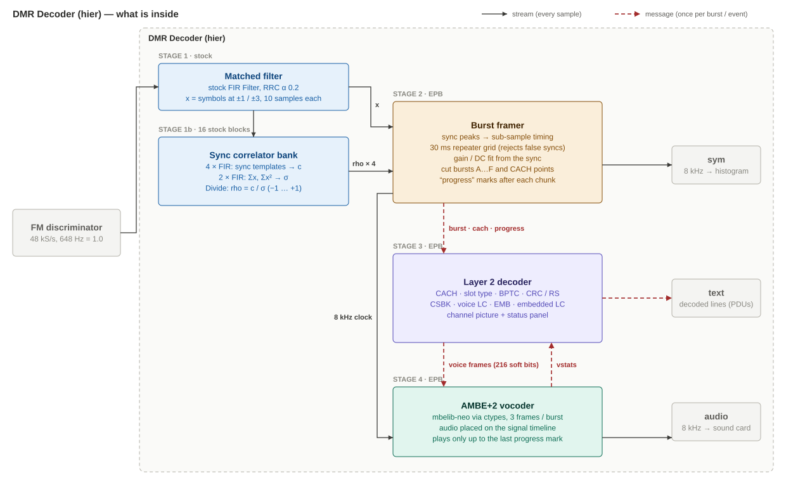
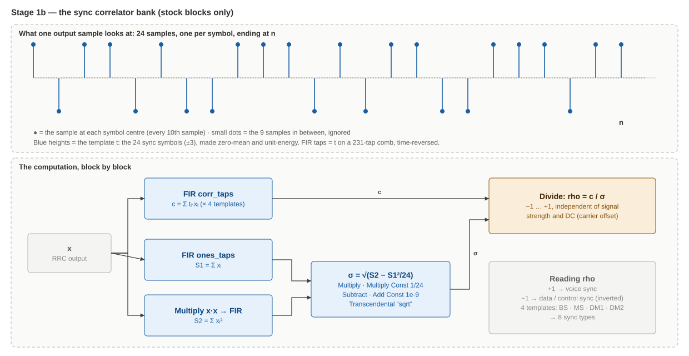
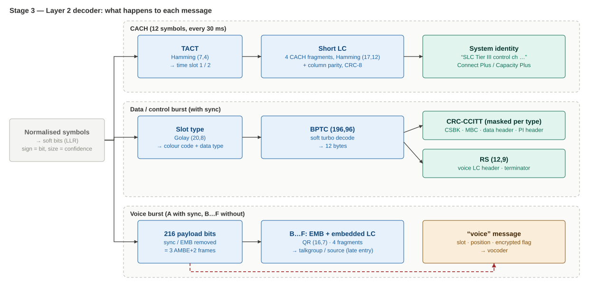
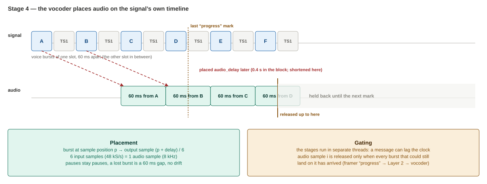

# DMR Decoder hier block (`dmr_decoder_hier.grc`): how it works inside

*Diagrams: `dmr_hier_overview.svg`, `dmr_hier_correlator.svg`, `dmr_hier_layer2.svg`, `dmr_hier_vocoder.svg`. Keep them in the same folder as this file.*

The same decoder as the single block in `dmr_rx.grc`, opened up into stages:

- **Stock blocks** where GNU Radio has them: the matched filter and the sync correlator bank.
- **Three small Embedded Python Blocks** for the rest: burst framer, Layer 2 decoder, AMBE+2 vocoder.

`dmr_rx_hier.grc` is the receiver that uses it. Its front end (RTL source → channel filters → FM discriminator) and GUI are unchanged.

---

## 1. The big picture

**Two kinds of connection:**
- **Streams** (solid sample flow) carry anything that happens every sample: the filtered signal, the four correlation curves, the 8 kHz outputs.
- **Messages** carry things that happen once per burst (every 30 ms): a burst's 144 symbols, a decoded voice frame, a status report.

---

## 2. Stage 1: matched filter (stock FIR Filter)

DMR transmitters shape every symbol with a **root-raised-cosine** filter (roll-off 0.2). Filtering again with the same shape at the receiver:
- removes as much noise as possible, and
- makes each symbol peak cleanly at its centre ("zero ISI").

`taps.rrc_taps()` builds the taps with `firdes.root_raised_cosine` and scales them to unity DC gain, so the symbol levels stay at ±1 / ±3.

---

## 3. Stage 1b: the sync correlator bank (stock blocks only)

Every DMR burst has a 48-bit **sync word** in the middle (24 symbols, all at the outer ±3 levels). Finding it tells us where the burst is and when its symbols are.

### What is computed

For each sample `n` we look at the 24 samples that would be the sync, one per symbol (every 10th sample), ending at `n`:

**Why normalise?** `rho` doesn't depend on the signal's strength or on a DC offset (carrier offset):
- the template has zero mean, so DC cancels in `c`;
- `σ` removes the scale.

`rho = +1` is a perfect voice sync, and `rho = −1` a perfect **data** sync, because DMR's data sync is the voice sync with every symbol inverted. That's why 4 templates cover 8 sync types:

| Template | Voice sync (rho → +1) | Data sync (rho → −1) |
|---|---|---|
| `BS`  | repeater voice | repeater data / control |
| `MS`  | mobile voice | mobile data |
| `DM1` | direct mode, slot 1 voice | slot 1 data |
| `DM2` | direct mode, slot 2 voice | slot 2 data |

The taps come from the **Python Module** block `taps` (`corr_taps`, `ones_taps`, `rrc_taps`). Open it in GRC to see exactly how the comb is laid out. This is the same normalised-correlation idea as your AIS preamble detector.

---

## 4. Stage 2: burst framer (EPB)

Input: `x` and the 4 `rho` streams. Output: messages, plus the 8 kHz symbol stream.

| Step | What and why |
|---|---|
| **Peak picking** | Every place where \|rho\| ≥ `sync_thresh` (0.8) is a local maximum gives a candidate sync. A parabola through the peak and its two neighbours gives the timing to a **fraction of a sample**. |
| **30 ms grid** | A repeater sends bursts on a fixed 30 ms grid (144 symbols). A sync off that grid is rejected, because AMBE voice data occasionally *looks like* a sync. The grid is trusted only after two syncs agree on it. |
| **Gain / DC fit** | The 24 known sync symbols give a least-squares fit `y = g·symbol + o`. It is refined over the whole burst using its own decisions. `o` × 648 Hz is the carrier offset, \|g\| × 1944 Hz the deviation (both shown in the panel). |
| **Cutting** | The burst is sampled at the measured timing (cubic interpolation), 144 symbols: 12 of CACH + 132 of burst, normalised to `(y − o)/g`. |
| **Voice superframes** | Voice bursts B..F carry **no sync**. After burst A they are cut out "blind" at +60, +120 … +300 ms. Then the next A is looked for at +360 ms; if the sync search missed it but a weak sync (rho ≥ 0.5) is there, it's used anyway. |
| **CACH points** | At every grid point the 12 CACH symbols are sent on, including in bursts without a sync. Short LC is built from them. |
| **Progress** | After each chunk: "every burst up to position *p* has been sent". The vocoder needs this (§6). |
| **Symbol output** | The sample at each symbol centre, held at 8 kHz. It drives the histogram and is the vocoder's clock. |

**Message format** (dict + float vector):

| `type` | dict fields | vector |
|---|---|---|
| `burst` | `pos` (sync start, in 48 kS/s samples), `kind`, `voice`, `n` (0 = has sync, 1..5 = B..F), `sf` (pos of this superframe's A), `g`, `o`, `offgrid` | 144 normalised symbols |
| `cach` | `pos` | 12 normalised symbols |
| `progress` | `pos` | – |
| `reset` | `rf_hz` (you retuned) | – |
| `tick` | (status panel due) | – |

---

## 5. Stage 3: Layer 2 decoder (EPB)

Input: framer messages. Output: text lines (printed, and PDUs on `text`) and voice frames.

It also keeps the **channel picture** (site, neighbours, channel plan, calls, encryption flags) and prints the status panel on each `tick`. The vocoder's report arrives on `vstats` and appears in the panel's "Voice audio" line.

The code tables and parsers are the same, already-tested code as the single-block decoder.

---

## 6. Stage 4: AMBE+2 vocoder (EPB)

Input: the 8 kHz clock stream and `voice` messages (216 soft bits = three 20 ms AMBE+2 frames). Output: 8 kHz audio.

1. Each slot has its own mbelib-neo state, which resets when a new call starts.
2. The 3 frames → 480 samples (60 ms).
3. **Placement:** they are written into an output timeline at `(burst position + audio_delay) / 6`. Six 48 kS/s samples make one 8 kHz sample, so audio is locked to signal time: pauses stay pauses, a lost burst stays a 60 ms gap, and nothing drifts.
4. **Gating:** output sample *i* is only released once Layer 2 has passed on a `progress` mark that guarantees no more audio can land on *i*.

**Why gating is needed.** The stages run in **separate threads**, and a message can arrive after the clock stream has moved on. Without gating, a fast input (a file) let the vocoder run ahead and play silence. During testing this also caught a subtle framer bug that made 1 burst in 9 superframes late.

Encrypted calls (PI header or the encrypted flag in LC) are muted. Slot selection (`audio_slot`) happens here.

---

## 7. Using it in GRC (Windows)

1. Put `dmr_decoder_hier.grc`, `dmr_rx_hier.grc` and `mbe-neo.dll` in one folder.
2. Open **`dmr_decoder_hier.grc`** and press **Generate** (F5, the "Generate the flow graph" button). GRC writes the block to `C:\Users\<you>\.grc_gnuradio\`: `dmr_decoder.py`, `dmr_decoder.block.yml` and one `.py` file per EPB.
3. **View → Reload Blocks** (or restart GRC). **"DMR Decoder"** appears in the block tree under **[DMR]**.
4. Open **`dmr_rx_hier.grc`** and run it.

**After editing anything inside the hier block:**
- Generate it again (step 2).
- If you added or renamed a parameter, reload the blocks (step 3).
- Code changes alone take effect the next time the main flowgraph runs.

**Exploring:** double-click any EPB inside `dmr_decoder_hier.grc` and press "Open in Editor" to read or change its code. A good experiment is a **QT GUI Time Sink** on one of the `rho_*` outputs: you'll see the sync peaks, about +1 for voice and −1 for data/control, every 30 ms.

---

## 8. Validation

| Test | Result |
|---|---|
| Decoded messages vs the single-block decoder: reference stream (calls, CSBK, data header) and a Tier III control-channel stream, at 20 dB and 9 dB CNR | **Identical**, line for line (48/48 and 66/66 lines) |
| Voice: text-to-speech → mbelib-neo AMBE+2 encoder → DMR call → RF IQ at 12 dB → compiled `dmr_rx_hier` flowgraph | Audio **identical** to a direct decode (correlation 1.000), 414/414 frames, 0 errors, 0 late |
| Speed (2-core test machine) | 2.6× real time. The stock filter bank alone runs at 200×; the three Python stages share Python's global interpreter lock. The single-block version runs at about 5× |

**Bugs found and fixed while building this:**
- A crash when the vocoder emitted fewer samples than offered.
- Burst B occasionally arriving after its progress mark: the framer now processes newly scheduled bursts in the same call.

**Dropped from the single-block decoder:** the "P25 syncs seen" hint in the status panel. It would need a fifth correlator.
