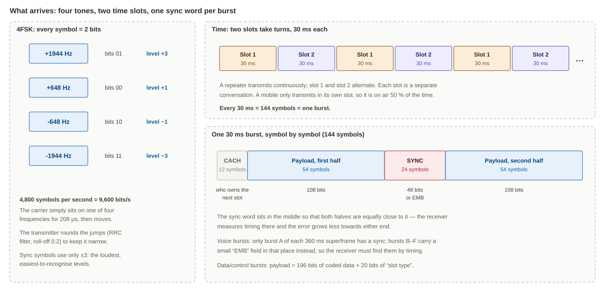
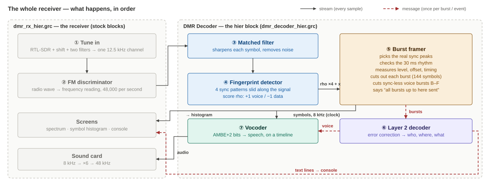
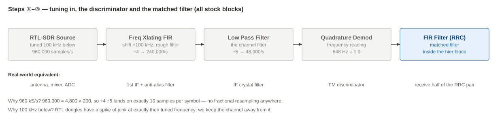
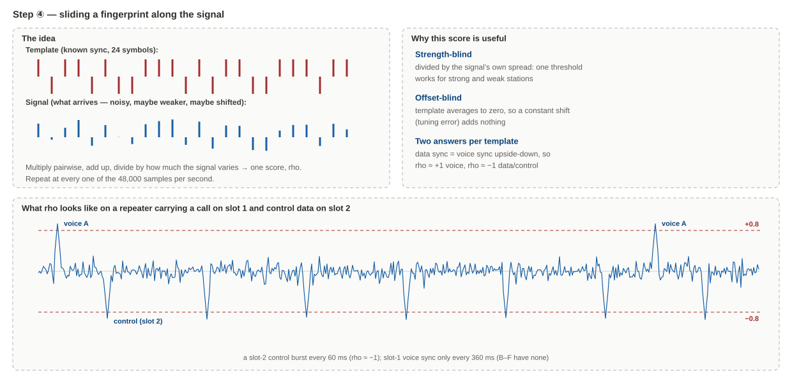
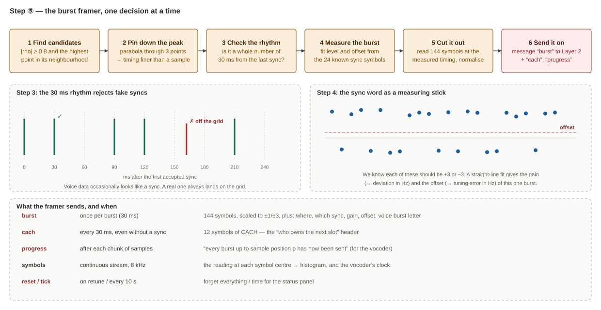
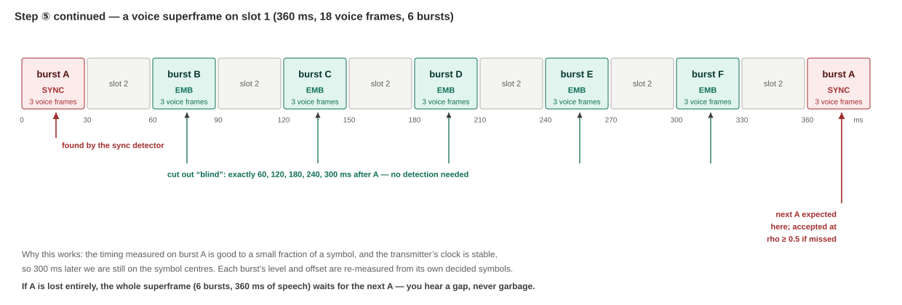
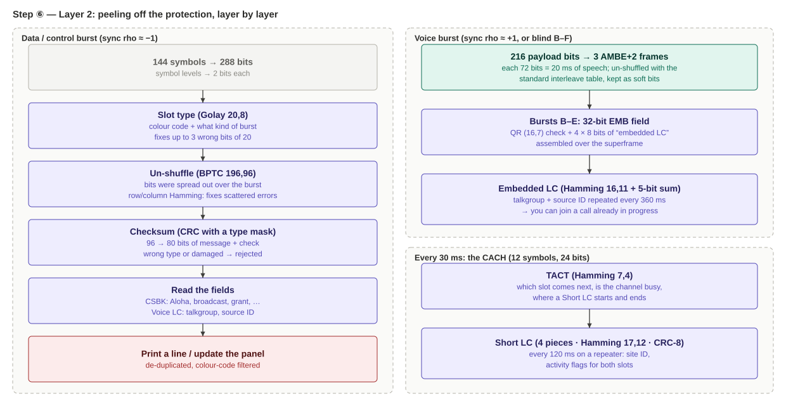
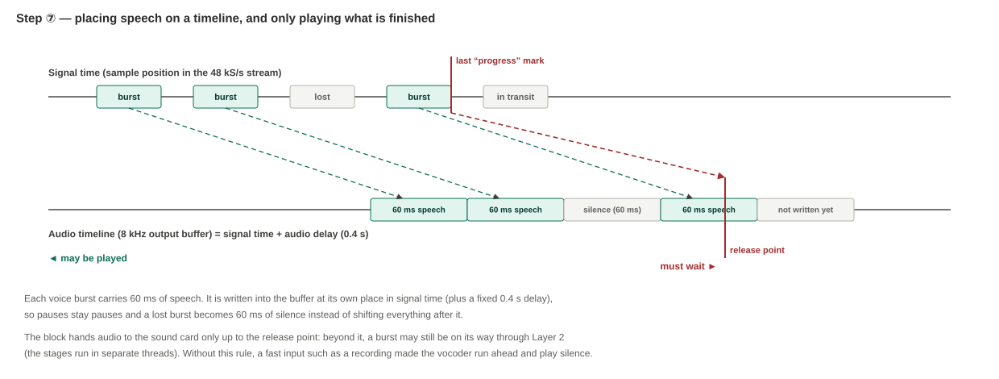
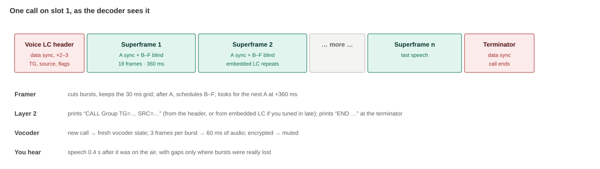

# How the DMR Decoder Works: A Plain-English Guide

**Files:**
- `dmr_decoder_hier.grc`: the decoder, built as a hier block.
- `dmr_rx_hier.grc`: the RTL-SDR receiver that uses it.

Both are for GNU Radio Companion 3.10.

**Who this is for:** radio amateurs and RF engineers who know DMR from the user side (talkgroups, timeslots, colour codes) and want to know what happens inside a receiver, step by step. You don't need any signal-processing maths.

**Companion documents:**
- `dmr_decoder_hier_explained.md` covers the same block in compact technical form.
- `dmr_how_it_works.md` explains the DMR system itself: repeaters, hotspots and networks.

**Diagrams:** the `dmr_pe_*.svg` files must be in the same folder as this document.

---

## Contents

1. [What the decoder does, in one paragraph](#1-what-the-decoder-does-in-one-paragraph)
2. [The decoder's problem in five minutes](#2-the-decoders-problem-in-five-minutes)
3. [The receiver at a glance](#3-the-receiver-at-a-glance)
4. [The settings you can change](#4-the-settings-you-can-change)
5. [Step 1: Tuning in](#5-step-1-tuning-in)
6. [Step 2: Turning the radio wave into frequency readings](#6-step-2-turning-the-radio-wave-into-frequency-readings)
7. [Step 3: Sharpening the symbols (the matched filter)](#7-step-3-sharpening-the-symbols-the-matched-filter)
8. [Step 4: Spotting sync words (the fingerprint detector)](#8-step-4-spotting-sync-words-the-fingerprint-detector)
9. [Step 5: Cutting out bursts (the framer)](#9-step-5-cutting-out-bursts-the-framer)
10. [Step 6: Reading the bursts (Layer 2)](#10-step-6-reading-the-bursts-layer-2)
11. [Step 7: Turning voice bits into speech (the vocoder)](#11-step-7-turning-voice-bits-into-speech-the-vocoder)
12. [Step 8: To the loudspeaker](#12-step-8-to-the-loudspeaker)
13. [What you'll see on the screen](#13-what-youll-see-on-the-screen)
14. [One call, start to finish](#14-one-call-start-to-finish)
15. [How we know it works, and what it can't tell you](#15-how-we-know-it-works-and-what-it-cant-tell-you)
16. [Using it with a real RTL-SDR on Windows](#16-using-it-with-a-real-rtl-sdr-on-windows)
17. [Things to try](#17-things-to-try)
18. [Glossary](#18-glossary)

---

## 1. What the decoder does, in one paragraph

A DMR repeater transmits continuously. Its signal is a stream of 30 ms bursts that alternate between two timeslots. Each burst carries either 60 ms of compressed speech or a small block of data: who is talking to whom, which site this is, which frequency to go to for a call.

This receiver listens to one DMR frequency through an RTL-SDR dongle and works through the following, in order:

1. It finds where each burst sits in time.
2. It reads its 144 symbols.
3. It strips away the error protection layer by layer.
4. It prints what the data says (colour code, timeslot, talkgroup, source ID, site and neighbours, channel grants).
5. With the free mbelib-neo library, it turns the voice bits back into audio you can hear.

The decoder is one block in the receiver, but inside it is built as a **hier block**, a flowgraph within the flowgraph. Every stage is a separate block you can open, probe and change:

- **Stock GNU Radio blocks** wherever they can do the job.
- **Three small Embedded Python Blocks** where they can't.

---

## 2. The decoder's problem in five minutes

### 2.1 What arrives



**Four tones.** DMR is a form of FM with four fixed frequency positions, called 4FSK:

- The carrier sits at +1944, +648, −648 or −1944 Hz from centre for one symbol (208 µs), then moves.
- Each position stands for two bits.
- There are 4,800 symbols per second, so 9,600 bits per second.
- The transmitter rounds off each jump with a filter (root-raised-cosine, roll-off 0.2) so the signal fits in a 12.5 kHz channel.

**Two timeslots.** Time is cut into 30 ms slices that alternate: slot 1, slot 2, slot 1, slot 2… Each slot is an independent conversation.

- A repeater transmits in both slots all the time. When nothing is happening it sends "idle" bursts.
- A mobile only transmits in its own slot, so it is on the air half the time.

This is why one repeater carries two talkgroups at once.

**One burst = 144 symbols = 30 ms:**

| Part | Symbols | What it is |
|---|---|---|
| CACH | 12 | A small header from the repeater: which slot comes next, whether the channel is busy, and pieces of a "Short LC" message |
| Payload, first half | 54 | 108 bits of voice or data |
| Sync (or EMB) | 24 | A fixed 48-bit pattern that says "a burst is here, and it is this kind". In most voice bursts it is replaced by a small "EMB" field |
| Payload, second half | 54 | Another 108 bits |

The sync sits **in the middle** on purpose. The receiver measures its timing there, and both halves of the payload are then equally close to the place where the timing is best known.

### 2.2 What the receiver doesn't know

| Unknown | Where it comes from | Typical size |
|---|---|---|
| **Where the bursts start** | We switch on at a random moment | Anywhere |
| **Symbol timing** | Where the best sampling instant falls within each 208 µs symbol | Any fraction of a symbol |
| **Tuning error** | The repeater's crystal plus your dongle's crystal | A few hundred Hz with a TCXO dongle, several kHz without |
| **Deviation** | Each transmitter's modulator is set up slightly differently | ±5 % around the nominal 1944 Hz |
| **Which slot is which** | The repeater tells us, in the CACH | Has to be decoded |
| **Which bursts are voice B–F** | Five out of six voice bursts have **no sync** at all | Has to be inferred from timing |

### 2.3 Why GNU Radio's standard blocks aren't enough on their own

A first attempt might be: FM demodulator, then `Symbol Sync` (clock recovery), then a 4-level slicer, then "search for the sync bits". That works for one steady signal. It falls short on DMR in four places:

- **The timing loop has to chase the signal.** Clock recovery adjusts a little at a time. When you retune, or a mobile keys up, it needs many symbols to get back into step. In an earlier version of this receiver it also drifted ("wound up") while you were sliding the tuning knob, so locking took seconds. This receiver measures each burst's timing directly from its sync word, so there is nothing to catch up.
- **Voice data can look like a sync word.** A bit-pattern search occasionally fires inside compressed speech. A real repeater, however, keeps a strict 30 ms rhythm, so a sync that's off the rhythm can be thrown away. GNU Radio has no block that knows about burst rhythms.
- **There are no DMR error-correction blocks.** DMR uses five different codes (Golay, BPTC, Hamming, quadratic-residue, Reed-Solomon) and several checksums with per-type masks. GNU Radio doesn't include any of them.
- **There is no AMBE+2 decoder.** The voice codec is proprietary. GNU Radio can't decode it; mbelib-neo can.

**The approach here:** use stock blocks for everything that runs on every sample (filtering, correlating) and Python for everything that happens once per burst.

---

## 3. The receiver at a glance



**Two kinds of arrows:**

- **Solid arrows are streams.** Numbers flow continuously, tens of thousands per second, like an audio cable.
- **Dashed red arrows are messages.** A packet is sent once per event, like an e-mail: "here is a burst", "here are three voice frames", "here is a line of text".

DMR is naturally a mix of the two. The radio signal is continuous, but the information comes in 30 ms packets.

| Step | Plain-English role | Real-world equivalent | Built from |
|---|---|---|---|
| ① Tune in | Moves the DMR channel to the centre and removes everything else | Mixer, IF filters | Stock blocks |
| ② Discriminator | Turns the radio wave into "how far off-centre is the frequency right now" | FM discriminator | Stock block |
| ③ Matched filter | Sharpens each symbol and removes noise | The receive filter in a DMR radio's modem | Stock block |
| ④ Fingerprint detector | Scores, at every instant, how much the last 24 symbols look like each sync pattern | The sync detector in a modem chip | 16 stock blocks |
| ⑤ Burst framer | Decides which sync peaks are real, measures each burst and cuts it out | The modem chip's burst timing and slicer | Embedded Python Block |
| ⑥ Layer 2 decoder | Error correction and checksums, then reads the fields and keeps the channel picture | The radio's protocol processor | Embedded Python Block |
| ⑦ Vocoder | Turns 49-bit voice parameters back into speech, on the right timeline | The AMBE+2 chip in your radio | Embedded Python Block + mbelib-neo |
| ⑧ Audio out | Raises the sample rate to what the sound card wants | The audio amplifier | Stock blocks |

---

## 4. The settings you can change

### In the receiver (`dmr_rx_hier.grc`)

| Setting | Default | Plain meaning |
|---|---|---|
| `dmr_freq` | 148.800 MHz | The repeater's output frequency (its downlink) |
| `rf_gain` (slider) | 29.7 dB | Dongle gain. Raise it for weak signals, lower it if strong nearby signals overload the dongle |
| `ppm` | 0 | Your dongle's crystal correction. 1 ppm at 148 MHz is about 148 Hz |
| `fine_hz` (slider) | 0 | Fine retuning in Hz, for whatever error `ppm` leaves |
| `lo_offset` | 100 kHz | The dongle is tuned this far below the channel, to stay clear of its centre spike |
| Audio gain (slider) | – | Volume after the vocoder |

### In the DMR Decoder block (double-click it)

| Setting | Default | Plain meaning |
|---|---|---|
| Sync threshold | 0.8 | How closely 24 symbols must match a sync pattern to count (0 to 1). Lower finds weaker bursts but more false alarms, which the 30 ms rhythm check then has to reject |
| Colour code | −1 (any) | Show only bursts with this colour code. Useful where two repeaters share a frequency |
| Repeat suppression | 10 s | The same line isn't printed again within this time. A repeater repeats its broadcasts constantly |
| Status panel every | 10 s | How often the summary panel is printed |
| RF frequency | `dmr_freq + fine_hz` | Only used to convert the measured offset into ppm, and to label the panel |
| Plan: reference LPCN / freq / step | 0 / 0 / 12500 | Your network's channel plan, so that channel numbers in grants can be turned into MHz (§10.6). Leave it at 0 if you don't know it |
| Play slot | 0 (both) | Which timeslot to hear: 1, 2, or 0 for both mixed |
| mbelib path | empty | Where `mbe-neo.dll` is, if it isn't next to the flowgraph |
| Audio delay | 0.4 s | How far behind the radio signal the audio plays (§11) |

---

## 5. Step 1: Tuning in

**Blocks:** `RTL-SDR Source` → `Frequency Xlating FIR Filter` → `Low Pass Filter`



1. **The dongle is tuned 100 kHz below the repeater.** Every RTL-SDR has a small spike of junk at exactly the frequency it's tuned to. It comes from DC offset in its mixer. Tuning off to one side keeps that spike out of our channel.
2. **The first filter slides the channel back to the centre**, cuts out everything beyond ±40 kHz, and keeps one sample in four: 960,000 → 240,000 samples per second. It only has to be good enough that nothing folds back into our channel when the rate drops. That keeps it cheap.
3. **The second filter is the real channel filter.** It removes everything outside the 12.5 kHz DMR channel and keeps one sample in five: 240,000 → 48,000 per second.

**Why these odd numbers?** DMR runs at 4,800 symbols per second. 960,000 = 4,800 × 200, so dividing by 4 and then by 5 lands on exactly **10 samples per symbol**. Every later stage can count in whole samples: one symbol is 10, one burst is 1,440, and one voice superframe is 17,280. There are no awkward fractions and no resampling.

---

## 6. Step 2: Turning the radio wave into frequency readings

**Block:** `Quadrature Demod`

This is the software version of an FM discriminator. For each of the 48,000 samples per second it outputs how far the signal's frequency is from the centre at that instant.

The scaling is chosen so that **648 Hz reads as 1.0**. The four DMR tones then read +3, +1, −1, −3, which are exactly the "symbol levels" the DMR standard talks about. A tuning error shows up as every reading being shifted up or down by the same amount. That shift is called the **offset**; the framer measures and removes it (§9.4).

Why demodulate as FM rather than something cleverer? DMR's 4FSK can be received coherently, but FM detection is what every DMR radio actually does. It doesn't care about the carrier's phase, and it's insensitive to the slow phase wander of a cheap dongle.

---

## 7. Step 3: Sharpening the symbols (the matched filter)

**Block:** `FIR Filter` with root-raised-cosine taps. This is the first block inside the hier block.

The transmitter rounds off each tone change with a root-raised-cosine (RRC) filter. Running the received signal through **the same shape again** does two things:

- **It removes as much noise as possible.** This is the "matched filter" idea: a filter shaped exactly like the expected signal lets the signal through and blocks the most noise. Think of a key cut to fit one lock.
- **It makes each symbol reach its level cleanly at its centre.** Two RRC filters in a row form a "raised-cosine" response. That response has a useful property: at the exact centre of each symbol, the neighbouring symbols contribute nothing. Sample there and you read +3, +1, −1 or −3 without interference from the symbols on either side.

The taps are scaled so the levels stay at ±1 and ±3. The output is called `x` in the diagrams. It is a stream of 48,000 numbers per second; every 10th number, if you pick the right ones, is a clean symbol.

**Which ones are "the right ones" is exactly what we don't know yet.** That's the next step.

---

## 8. Step 4: Spotting sync words (the fingerprint detector)

**Blocks:** four `FIR Filter`s, two more `FIR Filter`s, and about ten arithmetic blocks (`Multiply`, `Multiply Const`, `Subtract`, `Add Const`, `Transcendental` for the square root, `Divide`). All of them are stock.



### 8.1 The idea

Every burst that carries a sync carries one of a handful of known 24-symbol patterns. We take each pattern as a **fingerprint** and, at every one of the 48,000 samples per second, ask: *"If a sync ended right now, how well would the last 24 symbols match?"*

"The last 24 symbols" means 24 samples spaced exactly 10 apart, one per symbol, ending at the current sample. A FIR filter whose taps are zero except at every 10th position computes this naturally. That is why it can be done with stock blocks.

The match is turned into a score called **rho**, from −1 to +1:

1. **Correlate.** Multiply each received symbol by the matching fingerprint symbol and add them up. This is one `FIR Filter` per fingerprint. If the signal looks like the fingerprint, all the products are positive and the sum is large.
2. **Measure the spread.** Two more `FIR Filter`s add up the same 24 samples (Σx) and their squares (Σx²). From these the arithmetic blocks compute how much the signal varies over those 24 symbols (σ, the standard deviation).
3. **Divide.** rho = correlation / spread, with a fixed factor so that a perfect match reads exactly 1.

### 8.2 Why this score is so useful

| Property | How | Why it matters |
|---|---|---|
| **Doesn't care how strong the signal is** | Dividing by the spread cancels the signal level | One threshold (0.8) works for the repeater next door and the one 50 km away |
| **Doesn't care about tuning error** | Every fingerprint has as many +3 as −3 symbols, so a constant shift adds nothing to the correlation | You don't need a perfect `ppm` setting before anything decodes |
| **One fingerprint gives two answers** | DMR's data sync is the voice sync with every symbol flipped | rho ≈ +1 means "voice burst", rho ≈ −1 means "data or control burst" |

With four fingerprints (repeater, mobile, direct-mode slot 1, direct-mode slot 2), each giving a + or − answer, **4 detectors cover 8 sync types**:

| Fingerprint | rho → +1 means | rho → −1 means |
|---|---|---|
| BS | repeater voice | repeater data / control |
| MS | mobile voice | mobile data |
| DM1 | direct mode, slot 1 voice | slot 1 data |
| DM2 | direct mode, slot 2 voice | slot 2 data |

This is the same normalised-correlation idea as the AIS receiver's preamble detector. There it was a single fingerprint; here there are four.

### 8.3 What it looks like

The lower half of the diagram shows rho from the BS fingerprint on a repeater carrying a voice call on slot 1 and control data on slot 2:

- **Downward spikes to about −1 every 60 ms:** slot 2's control bursts, each with a data sync.
- **An upward spike to about +1 every 360 ms:** slot 1's voice. Only one burst in six carries a sync (§9.6).
- **Everything else** hovers around zero, because random data doesn't look like the fingerprint.

The spikes are one sample wide at the top. They line up exactly with the end of the sync word, which is where the timing measurement starts.

---

## 9. Step 5: Cutting out bursts (the framer)

**Block:** Embedded Python Block "DMR Burst Framer". Its inputs are `x` and the four rho streams.

Up to here, every block has worked on every sample without knowing anything about bursts. The framer is where the receiver starts to think in bursts. It is the most important block in the chain, so it gets the longest section.



### 9.1 Find candidates

The framer looks for places where |rho| ≥ 0.8 (the sync threshold) **and** rho is the highest point in its neighbourhood. A sync gives a sharp peak, but the samples just before and after it also score quite high, and we want only the top.

### 9.2 Pin down the peak

The true symbol centre almost never falls exactly on a sample; it lies somewhere between two. The framer fits a parabola (a smooth curve) through the peak sample and its two neighbours and takes the top of the curve. That gives the burst's timing to a small fraction of a sample.

An analogy: three measurements of a hill's height at three places along a path tell you roughly where the summit is, even if you didn't measure exactly on top.

### 9.3 Check the rhythm: the 30 ms grid

A repeater sends a burst every 30 ms, exactly. So once we have seen a real sync, every later real sync must land a whole number of 30 ms steps after it.

**Why this matters:** compressed voice is essentially random bits. Over hours, some stretch of it will match a sync pattern closely enough to pass 0.8. Without the grid check, each such event would start a garbage "burst", and in early versions it caused false lines and audio clicks. With it, the fake has to land within a twentieth of a burst of the grid as well, and that almost never happens.

**Rules:**

- The grid is only trusted after **two syncs agree on it within one second**. One sync could itself be a fake.
- Once trusted, it stays trusted for **half a second** after the last good sync, then has to be re-confirmed. After that the transmitter may have stopped, or you may have retuned.
- If a repeater (BS) sync was seen in the last two seconds, mobile and direct-mode syncs are ignored. On a repeater frequency they can only be fakes.

### 9.4 Measure the burst

We know what the 24 sync symbols *should* read: each one exactly +3 or −3. We have what they *actually* read. A straight-line fit through the 24 pairs ("received = gain × expected + offset") gives two numbers for this one burst:

| Measured | Meaning | Shown in the panel as |
|---|---|---|
| **Gain** | How big a "3" actually reads | Deviation in Hz (gain × 648 Hz × 3) |
| **Offset** | How far every reading is shifted | Carrier offset in Hz (offset × 648 Hz), and in ppm |

The framer then refines both over the whole burst. It decides all 144 symbols with the first estimate and fits again using all of them: 144 points give a steadier answer than 24.

This is the same "use the known part as a measuring stick" trick as in the AIS receiver. It's why the decoder doesn't need a perfectly tuned dongle: a 1 kHz error just becomes an offset that is measured and subtracted.

### 9.5 Cut it out

Knowing the timing to a fraction of a sample, the framer reads each of the 144 symbols at its exact centre. It interpolates between samples with a smooth curve (Catmull-Rom). It then removes the offset and divides by the gain, so the symbols come out as clean numbers near +3, +1, −1, −3.

**It does not round them yet.** A symbol that reads +2.1 is "probably +3, but not sure", while +2.9 is "certainly +3". That confidence is kept and used later by the error correction and the vocoder. Rounding now would throw it away.

### 9.6 The tricky part: voice bursts that have no sync



Voice is sent in **superframes** of six bursts, A to F, on the same slot, 60 ms apart. Together they hold 360 ms of speech. **Only burst A has a sync.** In B to F, the sync position carries a small 16-bit "EMB" field instead. It holds the colour code and a fragment of the talker information. DMR does this to fit more control information into a call without spending bandwidth on syncs.

So the fingerprint detector sees voice only once every 360 ms. The framer handles it like this:

1. When it accepts a burst A, it **schedules** B, C, D, E and F at exactly 60, 120, 180, 240 and 300 ms later, and cuts them out "blind" when the signal reaches those points.
2. The timing measured on A is good enough for that. The transmitter's clock is stable, and 300 ms later the error is still a small fraction of a symbol. Each blind burst's gain and offset are re-measured from its own symbols.
3. At 360 ms it expects the next A. If the detector found it, fine. If the detector *missed* it (rho stayed below 0.8 because of a fade), the framer checks the rho at that predicted position, and **0.5 is enough** there. We already know where to look, so a much lower score is still convincing.

**When burst A is lost entirely**, the framer doesn't guess. The whole superframe is skipped: 360 ms of silence, never 360 ms of garbled noise. The standard expects this, and it's what a real radio does too.

### 9.7 What the framer sends on

| Message | When | What it carries |
|---|---|---|
| `burst` | Once per burst | The 144 symbols plus: where it is, which sync, voice or data, letter A–F, gain, offset |
| `cach` | Every 30 ms on the grid, even for bursts without a sync | The 12 CACH symbols |
| `progress` | After every chunk of samples it processes | "Every burst up to position *p* has now been sent." The vocoder needs this (§11.3) |
| `reset` | When you retune | "Forget everything you knew about this channel" |
| `tick` | Every 10 s (by default) | "Time to print the status panel" |

It also outputs one **stream**: the symbol reading at each symbol centre, 4,800 per second, held so the stream runs at 8,000 per second. That stream drives the symbol histogram on the screen, and it is also the vocoder's clock (§11).

---

## 10. Step 6: Reading the bursts (Layer 2)

**Block:** Embedded Python Block "DMR Layer 2". It has message inputs only.



DMR protects almost everything it sends with error correction. The idea is the same as in any digital radio system: add carefully chosen redundant bits so that a receiver can work out and repair a few wrong bits. Different parts of a burst get different codes, depending on how important they are and how many bits there are. Layer 2 undoes them one by one, like peeling an onion.

It uses each symbol's confidence (§9.5). "Soft" decoding of this kind fixes noticeably more errors than working with rounded bits, because the decoder knows which bits are doubtful.

### 10.1 Every 30 ms: the CACH

The 12 CACH symbols (24 bits) are only sent by a repeater. They contain two things:

- **TACT** (7 bits, Hamming (7,4) code, which corrects 1 wrong bit). It says:
  - which slot the **next** burst belongs to. This is how we know whether a burst is slot 1 or slot 2;
  - whether the channel is busy;
  - whether this CACH starts, continues or ends a Short LC message.
- **A fragment of Short LC** (17 bits). Four fragments, over 120 ms, make one Short LC message: 36 bits of data, Hamming (17,12) per row, plus a CRC-8 checksum. On a Tier III control channel it carries the site identity. On a conventional repeater it says what each slot is doing.

### 10.2 Data and control bursts

Bursts with a **data** sync (rho ≈ −1) go through these layers:

1. **Slot type** (20 bits: 10 each side of the sync, Golay (20,8) code, which corrects up to 3 wrong bits). It gives the **colour code** and **what kind of burst this is**: voice header, terminator, CSBK, idle, data header, and so on. If it can't be repaired, the burst is dropped. Without knowing the type, nothing else can be read.
2. **BPTC (196,96)**. The remaining 196 bits are 96 bits of information, arranged in a grid with Hamming check bits on every row and column, then **shuffled** across the burst. The shuffle spreads out a burst of noise (a short fade, a click), so that after un-shuffling the errors are scattered. Scattered errors are exactly what row-and-column codes are good at.
3. **Checksum**. The 96 bits are 80 bits of message plus a check:
   - a CRC-16 for most burst types;
   - Reed-Solomon (12,9) for the voice header and terminator.

   Each burst type XORs its check with a **different mask**, so a burst decoded as the wrong type fails the check. A failed check means the burst is dropped and counted in the panel's "rejected" figures.
4. **Read the fields.** What's in the 80 bits depends on the type:

| Burst type | What Layer 2 prints or learns |
|---|---|
| Voice LC header | `CALL Group TG=… SRC=…`: a call starts, with its talkgroup and source ID, plus emergency and encryption flags |
| Terminator with LC | `END …`: the call ended |
| PI header | The call is encrypted: algorithm, key ID |
| CSBK (control block) | Tier III control: C_ALOHA, C_BCAST (site, neighbours, frequencies), channel grants |
| Data header | A data transmission: GPS, text, etc. with source and destination |
| Idle | Nothing; only counted |

### 10.3 Voice bursts

Bursts with a **voice** sync (rho ≈ +1), and the blind bursts B–F, carry 216 payload bits. That is **three AMBE+2 voice frames of 72 bits each**, each frame 20 ms of speech. Layer 2:

- puts the bits back in their original order. The standard specifies an interleave table so that a noise burst hits different frames rather than wiping out one;
- passes them to the vocoder **as soft values** (each with a confidence), along with the slot, the burst's position in time and whether the call is encrypted.

Layer 2 does **not** error-correct the voice itself. AMBE+2 has its own protection inside each 72-bit frame, and the vocoder handles it (§11).

### 10.4 Bursts B–F: the embedded LC

The 16-bit EMB field in bursts B–F is protected by a quadratic-residue (16,7) code, which corrects up to 2 wrong bits. It carries the colour code and says whether this burst carries a piece of **embedded LC**.

Bursts B, C, D and E each carry 32 bits of embedded LC. Together they make 128 bits:

- 72 bits of call information (the same talkgroup and source ID as the voice header);
- Hamming (16,11) on each row, a parity check on each column, and a 5-bit checksum.

**Why it matters:** the voice header is sent only at the start of a call. If you tune in halfway through, you missed it. The embedded LC repeats the talker information **every 360 ms during the call**, so the decoder can tell you who's talking within half a second of tuning in. Real DMR radios do the same, which is why a radio shows the caller's ID even when you key up late.

### 10.5 The channel picture

Layer 2 also **remembers** what it has learned, and prints it as the status panel (§13.3):

- the measured carrier offset and deviation (median of recent bursts);
- channel type (repeater, mobile, direct mode, Tier III control channel);
- site identity and neighbour sites with their control-channel frequencies;
- colour codes seen, what each slot is doing right now, and recent calls;
- counters for bursts decoded and rejected (and why).

### 10.6 Turning channel numbers into frequencies

A Tier III network doesn't send frequencies in its grants. It sends **channel numbers** (LPCN), to keep the messages short. Some sites also broadcast the frequency for each channel number (C_BCAST "Chan_Freq"). When they do, Layer 2 learns the mapping and uses it.

When they don't, you can enter the network's **channel plan**: one known channel number, its frequency and the channel spacing. From the printouts we confirmed this one for your network:

> **Channel n = 148.7215 MHz + (n − 151) × 12.5 kHz**

With the plan entered, every grant and neighbour line shows a frequency in MHz.

---

## 11. Step 7: Turning voice bits into speech (the vocoder)

**Block:** Embedded Python Block "AMBE+2 Vocoder". It calls mbelib-neo, a free AMBE+2 decoder library.



### 11.1 What a vocoder does

AMBE+2 doesn't send a sound wave; it sends a **description** of one. Every 20 ms it sends:

- the pitch of the voice;
- how loud each frequency band is;
- whether each band is voiced (a vowel, a hum) or unvoiced (a hiss, an "s").

Those are 49 bits of parameters plus 23 bits of protection, 72 bits per frame. The vocoder rebuilds a sound wave from that description: 160 audio samples at 8 kHz.

That's why DMR speech sounds slightly synthetic, and why a few wrong bits make it warble rather than click.

The block uses mbelib-neo's **soft-decision** decoder. It receives each bit's confidence from the framer (§9.5), which lets its internal error correction repair more frames than it could with plain 0s and 1s.

### 11.2 One vocoder per slot, fresh for each call

Speech decoding depends on the previous frame. AMBE+2 sends some parameters as "the change since last time". So the block keeps **one vocoder state per slot**. When a new call starts (no voice on that slot for more than about 0.2 s), that slot's state is reset. A new talker doesn't start with the previous talker's voice characteristics.

**Encrypted calls are muted.** If the voice header, embedded LC or a PI header says the call is encrypted, decoding it would produce loud noise. You get a single "encrypted call: audio muted" line instead.

### 11.3 The timeline: why audio is placed rather than queued

The obvious design is a queue: decode three frames, put 60 ms of audio in the queue, and let the sound card take it out. It doesn't work well here:

- **Pauses disappear.** A 2-second gap between overs vanishes, and the next over starts early.
- **Lost bursts shift everything.** A missing superframe makes the rest of the over play 360 ms early. Over a long call the audio drifts against the signal.
- **GNU Radio delivers data in chunks** of unpredictable size, so the queue alternates between empty (stutter) and overfull (lag).

Instead, each burst's 60 ms of audio is **written into a timeline at the same moment it was on the air**, plus a fixed delay (0.4 s by default). The burst's sample position, which the framer recorded, says exactly where.

- A pause stays a pause.
- A lost burst becomes 60 ms of silence, and nothing after it moves.
- Nothing can drift, because audio time is tied to signal time.

### 11.4 Only play what's finished: the release point

The vocoder's output must be a steady 8,000 samples per second, so it needs a clock. That clock is the framer's 8 kHz symbol stream (§9.7), so the vocoder runs in step with the signal.

The catch is that the framer, Layer 2 and the vocoder **run in separate threads**. A voice message can still be on its way through Layer 2 when the clock has already moved past the point where its audio belongs. If the vocoder played that stretch of timeline, it would be silence; the speech would arrive a moment too late, and be dropped.

So the block only plays audio **up to the release point**: the last `progress` mark from the framer, plus the audio delay. Beyond that point a burst could still arrive. Before it, every burst has already been delivered.

This rule was added after testing showed the problem. With a fast input (a recording rather than a live dongle), the vocoder ran ahead and played silence. The same test then caught a subtle framer bug that made one burst in nine superframes late.

---

## 12. Step 8: To the loudspeaker

**Blocks:** `Multiply Const` (the volume slider), `Rational Resampler` (×6), `Audio Sink` (48 kHz).

The vocoder produces 8,000 samples per second. Most Windows sound cards want 48,000, so the resampler multiplies by six. The 0.4 s audio delay means **you hear speech about 0.4 s after it was on the air**. That's the price of never stuttering. You can lower it (§17); on a slower laptop, too low brings back gaps.

The volume is set in the receiver, not in the decoder. The decoder's output is about ±1 at full scale. Values beyond ±1 are clipped rather than wrapped, so loud syllables distort gently instead of crackling.

---

## 13. What you'll see on the screen

### 13.1 Spectrum

The `QT GUI Frequency Sink` shows the 240 kHz around the channel. A DMR repeater is a flat-topped hump about 10 kHz wide that never switches off. A mobile in direct mode appears and disappears at a 30 ms rate, so it looks like a flickering hump.

### 13.2 Symbol histogram

This is a histogram of the framer's 8 kHz symbol stream: how often each symbol reading occurs.

| What you see | What it means |
|---|---|
| **Four sharp, equal peaks at −3, −1, +1, +3** | Locked, clean signal |
| Four peaks, all shifted sideways | Tuning error. The framer removes it, but correct `ppm` / `fine_hz` anyway |
| Peaks spread wider and merging | Weak signal or interference |
| One blob, no peaks | No DMR here, or the framer hasn't locked yet |

### 13.3 Console

Event lines are printed as they happen. These are real lines from a test run:

```
[DMR 20:43:41] TS2 CC1 CALL Group TG=6001 SRC=423  (dev=1956Hz off=+130Hz)
[DMR 20:43:41] CACH SLC Tier III control ch (C_SYS_Parms) syscode 200D (large) Net 1 Site 14 reg=1
[DMR 20:43:46] TS2 CC1 END  Group TG=6001 SRC=423  (dev=1944Hz off=+132Hz)
```

Reading the first line:

- **TS2** is the timeslot, taken from the CACH (§10.1).
- **CC1** is the colour code, from the slot type (§10.2).
- **CALL Group TG=6001 SRC=423** is a group call to talkgroup 6001 from radio ID 423.
- **dev** and **off** are this burst's deviation and carrier offset (§9.4).

The status panel is printed every 10 s:

```
 DMR channel status   20:43:43   (running 1 s)
 Frequency   : 148.80000 MHz   carrier offset +129 Hz  ~+0.9 ppm   deviation 1958 Hz
 Channel type: repeater / base station (BS sync); Tier III CONTROL channel (TSCC)
 Site        : syscode 200D (large) Net 1 Site 14
 Colour code : CC1 (84 bursts)
 TS1         : idle
 TS2         : voice Group TG=6001 SRC=423
 Channel plan: (configured) LPCN n = 148.72150 MHz + (n - 151) x 12.500 kHz
 Calls (last 5 min, newest first):
    20:43:43  Group TG=6001 SRC=423                voice here on TS2
 Decoder     : bursts 154 (idle 81, voice superframes 12)  rejected: slot-type 0, BPTC 0, CRC/RS 0, off-grid/unconfirmed sync 3
```

**The last line is the health check.** "Off-grid/unconfirmed sync 3" means three fake or unconfirmed syncs were caught by the rhythm check (§9.3). A few is normal. Many BPTC or CRC rejections mean the signal is too weak, or you're catching a second repeater on the same frequency. If so, try setting the colour code.

When voice audio is active, the panel also gets a "Voice audio" line: the library in use, which slot is playing, and the average number of bit errors the vocoder corrected per frame.

---

## 14. One call, start to finish



Here is what happens when a station keys up on slot 1 of the repeater:

| Moment | On the air | In the decoder | On your screen / speaker |
|---|---|---|---|
| 0 ms | Voice LC header bursts (data sync) | rho spikes to −1; framer accepts (grid already confirmed by idle bursts); Layer 2 decodes slot type → BPTC → RS → talkgroup and source | `CALL Group TG=… SRC=…` |
| ≈ 60–120 ms | Burst A (voice sync) | rho spikes to +1; framer cuts A, schedules B–F; Layer 2 sends three voice frames; the vocoder starts a fresh state for slot 1 | Panel: "TS1: voice …" |
| +60 … +300 ms | Bursts B–F (no sync) | Cut out blind; EMB decoded; embedded LC collected from B–E | Repeated `CALL` line suppressed (same text within 10 s) |
| ≈ 0.4–0.5 s | (still talking) | The first speech reaches the release point | **You hear the first syllable** |
| Every 360 ms | Next A, B–F … | Next A expected at +360 ms, accepted at rho ≥ 0.5 if weak | Continuous speech |
| End | Terminator with LC | Layer 2 decodes it | `END Group TG=… SRC=…`; panel shows the call as "ended" |

If you tune in **halfway** through the call, the first two rows never happen for you. Within one superframe (360 ms) the embedded LC from bursts B–E still tells you who is talking, and the audio starts at the next burst A.

---

## 15. How we know it works, and what it can't tell you

### 15.1 What was tested

| Test | How | Result |
|---|---|---|
| **Same answers as the single-block decoder** | Two recorded test streams (calls with header, CSBKs and data; and a Tier III control channel) at strong (20 dB) and weak (9 dB) signal levels, through both versions | **Identical** output, line for line (48/48 and 66/66 lines) |
| **Voice, end to end** | Text-to-speech → mbelib-neo's own AMBE+2 encoder → a DMR call → radio signal with noise → the compiled `dmr_rx_hier` flowgraph | At 12 dB: all 414 frames decoded, 0 errors, audio identical to a direct decode (correlation 1.000) |
| **Voice at lower signal levels** | Same chain, weaker signal | 9 dB: small audible difference (0.4 dB spectral distance; the remaining errors are in AMBE's unprotected bits). 6 dB: still intelligible |
| **Speed** | 2-core test machine | 2.6× faster than real time. The stock filters alone run at 200× |
| **Real air** | Your own printouts from the single-block version on the real network | Network structure, sites, channel plan and calls decoded consistently. The plan was confirmed by three independent points |

### 15.2 What remains unconfirmed

- **The hier version hasn't run on your dongle yet.** It gives the same output as the single-block version on recordings, and that version worked on your real signals. Running the hier version on your laptop is still the final test.
- **Speed on Windows.** The three Python stages share one Python interpreter lock, so this version is about half as fast as the single block. 2.6× real time leaves margin, but a slow laptop with other programs running could get close to the limit. You'd hear it as gaps, and the panel's voice line would report "bursts too late". The single-block `dmr_rx.grc` remains the faster option.
- **The tests only have background noise.** They don't include multipath on a moving car, two repeaters on the same frequency, or a dongle overloaded by a nearby pager transmitter.
- **Dropped from the single-block version:** the "P25 syncs seen" hint. It would need a fifth correlator.
- **Not decoded:** encrypted voice (by design), and the content of multi-block data transfers (GPS, text messages). Only their headers are shown.

---

## 16. Using it with a real RTL-SDR on Windows

1. **Put the files in one folder:** `dmr_decoder_hier.grc`, `dmr_rx_hier.grc`, and `mbe-neo.dll` (plus any DLLs it depends on).
2. **Build the hier block once.** Open `dmr_decoder_hier.grc` in GNU Radio Companion and press **Generate** (F5). GRC writes the block into `C:\Users\<you>\.grc_gnuradio\`.
3. **View → Reload Blocks** (or restart GRC). "DMR Decoder" now appears in the block list under **[DMR]**.
4. **Open `dmr_rx_hier.grc`** and set:
   - `dmr_freq` to the repeater's output frequency;
   - `ppm` to your dongle's correction. A TCXO dongle (RTL-SDR Blog v3/v4) can stay at 0.
5. **Run it.** The first console line says whether the vocoder library was found:
   - `[DMR] voice: mbelib-neo 2.x (soft decision) …` means voice will play;
   - `… OFF - no AMBE+2 vocoder` means data decodes but audio is silent. Put `mbe-neo.dll` next to the flowgraph, or set **mbelib path** in the decoder's properties.
6. **Check the histogram.** You want four clean peaks. If they're shifted sideways, adjust `fine_hz` until they centre on ±1, ±3. The panel's "carrier offset" tells you by how much.
7. **Choose a slot to listen to** with **Play slot**. On a busy repeater, "both" can mix two conversations.
8. **After changing anything inside the hier block**, generate it again (step 2). If you added or renamed a parameter, also reload the blocks (step 3).

**On the legal side:** listening to amateur DMR is unrestricted. Listening to commercial or public-safety networks is legal in some countries and restricted in others, and passing on what you hear often isn't. Check your local rules. This receiver deliberately doesn't attempt to decrypt anything.

---

## 17. Things to try

| Try this | What you'll learn |
|---|---|
| Open `dmr_decoder_hier.grc` and put a **QT GUI Time Sink** on `rho_bs` | The fingerprint spikes from §8.3, live: −1 every 60 ms on a control slot, +1 every 360 ms during voice |
| Add a Time Sink on all four `rho_*` outputs at once | On a repeater only BS spikes; a direct-mode QSO lights up DM1 or DM2 instead |
| Lower **Sync threshold** to 0.6 | More "off-grid/unconfirmed" rejections in the panel: the rhythm check doing its job |
| Raise it to 0.95 | Weak bursts are missed; voice gaps appear as whole superframes (§9.6) |
| Set **Colour code** to a wrong value | Everything disappears. That's how a radio ignores a neighbour repeater on the same frequency |
| Set `fine_hz` to +1000, then +2500 | The histogram peaks shift, but decoding continues because the framer measures and removes the offset. At large offsets the channel filter starts cutting the signal |
| Set **Audio delay** to 0.1 s | Lower lag. If the panel's voice line starts showing "bursts too late: raise audio_delay", your PC needs the larger delay |
| Double-click the framer EPB and press "Open in Editor" | Every step in §9 is a short, commented section of Python |
| Record the IQ with a `File Sink`, then play it into both `dmr_rx.grc` and `dmr_rx_hier.grc` | Side-by-side proof that both give the same lines, on your own signals |

---

## 18. Glossary

| Term | Meaning here |
|---|---|
| **DMR** | Digital Mobile Radio (ETSI TS 102 361): two-slot TDMA digital voice and data in a 12.5 kHz channel |
| **4FSK** | FM with four fixed frequency positions; each symbol carries 2 bits |
| **Symbol** | One 208 µs step at one of the four frequencies |
| **TDMA / timeslot** | Time-sharing: slot 1 and slot 2 take turns, 30 ms each |
| **Burst** | One 30 ms transmission in one slot: 144 symbols |
| **CACH** | The 12-symbol header a repeater puts before each burst: slot numbering, busy flag, Short LC fragments |
| **Sync word** | A fixed 48-bit pattern in the middle of a burst that says "a burst is here, and it is this kind" |
| **EMB** | The 16-bit field that replaces the sync in voice bursts B–F: colour code plus embedded-LC control |
| **Colour code (CC)** | 0–15; like a CTCSS tone for DMR. Radios ignore bursts with the wrong one |
| **Superframe** | Six voice bursts A–F = 360 ms of speech; only A has a sync |
| **LC (Link Control)** | Call information: talkgroup, source ID, flags. Sent in the voice header, embedded in B–E, and in the terminator |
| **Short LC** | A small message built from four CACH fragments, every 120 ms |
| **CSBK** | Control Signalling Block: one-burst control messages (Tier III Aloha, broadcasts, grants) |
| **Tier III** | DMR's trunked mode: a control channel assigns calls to traffic channels |
| **LPCN** | Logical physical channel number: how Tier III refers to frequencies in its messages |
| **Slot type** | 20 bits in every data burst: colour code + burst type, Golay-protected |
| **BPTC** | Block product turbo code: rows and columns of Hamming codes, with shuffling |
| **CRC / RS** | Checksums: CRC-16 for most bursts, Reed-Solomon (12,9) for voice header and terminator |
| **Soft bits** | Bits that keep their confidence ("probably 1") instead of being rounded to 0 or 1 |
| **AMBE+2** | The proprietary voice codec in DMR: 72 bits per 20 ms frame |
| **mbelib-neo** | A free library that decodes AMBE+2; the vocoder block loads it as `mbe-neo.dll` |
| **Vocoder** | A codec that describes speech (pitch, spectrum, voicing) rather than sending the waveform |
| **Matched filter / RRC** | A filter shaped like the expected signal. RRC = root-raised-cosine, DMR's pulse shape |
| **rho** | The fingerprint detector's match score, −1 to +1 |
| **Grid** | The 30 ms rhythm of a repeater's bursts; syncs off it are rejected |
| **Hier block** | A GNU Radio block made of other blocks: a flowgraph inside a flowgraph |
| **Embedded Python Block (EPB)** | A custom block written in Python inside the `.grc` file |
| **Stream vs message** | Continuous sample flow vs one packet per event |
| **ppm** | Parts per million; 1 ppm at 148 MHz ≈ 148 Hz of tuning error |
